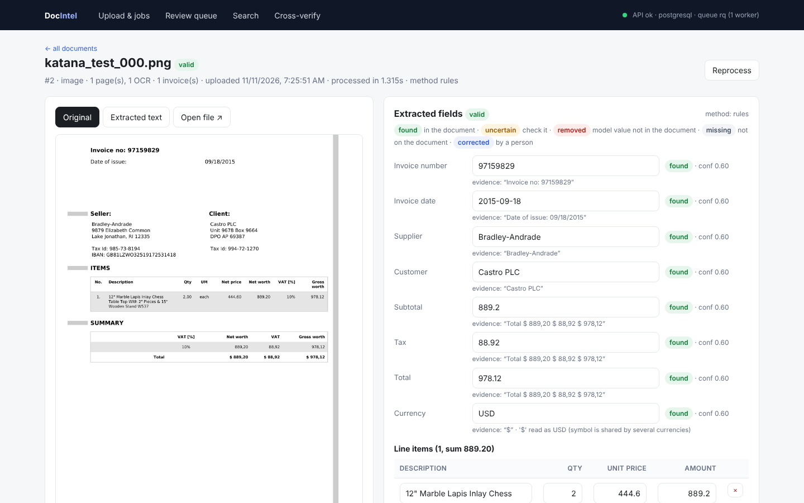

# DocIntel — AI-powered document intelligence for invoices

DocIntel turns invoices in any common format into structured, validated, searchable data. Upload digital or
scanned PDFs, JPG/PNG/TIFF images, or XLSX/XLS/CSV files. The system reads them, OCRs pages that have no text
layer, extracts nine fields plus line items with an LLM, rejects any value that is not actually in the document,
runs validation rules (math, dates, duplicates), stores everything in PostgreSQL, and shows results in a web UI.
There you can review and correct values, search, and cross-check PDFs against an Excel ledger.



| Task | Where |
|---|---|
| 1. Document processing (PDF text/OCR, images, TIFF, XLSX/XLS/CSV, corrupted files, long PDFs) | `Code/docintel/ingest/` |
| 2. AI extraction (9 fields + line items, JSON, no invented values) | `Code/docintel/extract/` · prompts in [`docs/prompts.md`](docs/prompts.md) |
| 3. Validation and verification (math, dates, duplicates, cross-verification) | `Code/docintel/validate.py`, `Code/docintel/crossverify.py` |
| 4. Backend API (upload, status, results, search, corrections, reprocess) | `Code/api/` · [`Code/api/README.md`](Code/api/README.md) |
| 5. Database and search (PostgreSQL, full-text, pgvector semantic) | `Code/api/models.py`, `Code/api/search.py` · [`docs/db_schema.md`](docs/db_schema.md) |
| 6. Frontend (upload + progress, review/correct, search, cross-verify) | `web/` |
| 7. Testing and evaluation | `Code/tests/` · [`docs/test_results.md`](docs/test_results.md) · [`docs/eval_report.md`](docs/eval_report.md) |

Architecture: [`docs/architecture.md`](docs/architecture.md) · AI-assistance disclosure: [`docs/ai_disclosure.md`](docs/ai_disclosure.md)

**Demo video:** _link will be added here_ · **Sample files to try:** [`samples/`](samples/)

---

## Quick start

### Prerequisites

| Needed for | Install |
|---|---|
| Option A (Docker) | Docker with Compose v2 (`docker compose version`). On Linux, add yourself to the `docker` group: `sudo usermod -aG docker $USER && newgrp docker` |
| Option B/C (local) | Python 3.11+, Node.js 20+, Tesseract (`sudo apt install -y tesseract-ocr`) |
| LLM extraction + semantic search (optional) | [Ollama](https://ollama.com) and a GPU with about 8 GB VRAM. Without it, see "No GPU" below |

Ports used: 3000 (web), 8000 (API), 5432 (PostgreSQL), 6379 (Redis). If one is taken, change it in
`docker-compose.yml` and in `.env` (see the table below).

### No GPU / no Ollama

Everything still runs. Put these two lines in `.env` before starting:

```bash
DOCINTEL_LLM_PROVIDER=none     # rules baseline instead of the LLM (97.6% field accuracy vs 98.4% with the LLM, see Evaluation)
EMBED_PROVIDER=hash            # simple local embeddings for semantic search
```

Or use a hosted model instead of Ollama (OpenAI, Claude, Gemini): see the options in `.env.example`.
If the LLM or embedding server is unreachable, processing falls back to the rules baseline and search falls back to
keyword search, so nothing crashes.

### Option A: everything in Docker

```bash
cp .env.example .env                       # then edit API_KEY
# LLM + embeddings run in Ollama on the host GPU:
ollama pull qwen2.5:7b && ollama create qwen2.5-8k -f Code/Modelfile.qwen && ollama pull nomic-embed-text
docker compose up --build                  # postgres (pgvector), redis, api, worker, web
```
When the containers are running, open `http://localhost:3000` in a browser on the same machine
(API docs: `http://localhost:8000/docs`). These addresses point to your own computer, so they only work while the stack is up.
Ollama must accept connections from containers: start it with `OLLAMA_HOST=0.0.0.0 ollama serve`
(or skip Ollama with the "No GPU" settings above).

### Option B: development (services in Docker, code in a venv)

```bash
python3 -m venv .venv && source .venv/bin/activate
pip install -r Code/requirements.txt
sudo apt install -y tesseract-ocr
cp .env.example .env
docker compose up -d postgres redis        # Postgres on host port 5433 if 5432 is taken (edit both files)

cd Code
uvicorn api.main:app --port 8000                     # terminal 1: API
rq worker docintel --url redis://localhost:6379/0    # terminal 2: worker (start more for more throughput)

cd ../web && cp .env.local.example .env.local && npm install && npm run dev   # terminal 3: UI
```

### Option C: no services at all

Set `DATABASE_URL=sqlite:///data/app.db` and `QUEUE_MODE=thread` in `.env`, then run only
`uvicorn api.main:app` and the web app. Processing then runs in background threads inside the API.

### Try it

1. Open http://localhost:3000 and drop the files from [`samples/`](samples/) on the upload area. Each file shows its
   progress (queued → processing → done). [`samples/README.md`](samples/README.md) lists what each file should produce.
2. Click a document to see the page preview, the extracted fields and the validation issues. Correct a value and save.
3. **Search**: try `Ottilies` or `10260` in keyword, semantic and hybrid mode.
4. **Cross-verify**: pick `northwind_10260.pdf` and `northwind_ledger.xlsx`.

Or with the API only:

```bash
KEY=change-me                                    # the API_KEY from .env
curl -s -H "X-API-Key: $KEY" -F "files=@samples/planted_10265.pdf" http://localhost:8000/api/documents
curl -s -H "X-API-Key: $KEY" http://localhost:8000/api/documents/1/results      # when status is "done"
curl -s -H "X-API-Key: $KEY" "http://localhost:8000/api/search?q=10260&mode=hybrid"
```

If documents stay `queued`, no worker is running: `curl -s -H "X-API-Key: $KEY" http://localhost:8000/api/health`
shows `"workers": 0`. Start one with `cd Code && rq worker docintel` (Option B) or use `QUEUE_MODE=thread`.

### Configuration (`.env`)

| Variable | Meaning |
|---|---|
| `DOCINTEL_LLM_PROVIDER` / `_MODEL` / `_BASE_URL` / `_API_KEY` | `openai` (any OpenAI-compatible server: Ollama, vLLM, OpenAI, Gemini) or `anthropic`; `none` = rules only |
| `DOCINTEL_OCR` | `auto` (EasyOCR on GPU if installed, else Tesseract) · `tesseract` · `easyocr` |
| `DATABASE_URL` | PostgreSQL (`postgresql+psycopg://…`) or SQLite |
| `QUEUE_MODE`, `REDIS_URL` | `rq` (Redis + workers) · `thread` · `sync` |
| `API_KEY` | required in the `X-API-Key` header; the web app adds it server-side |
| `EMBED_PROVIDER`, `EMBED_MODEL` | semantic search embeddings: `openai` (e.g. Ollama `nomic-embed-text`) · `sentence_transformers` · `hash` · `none` |
| `MAX_UPLOAD_MB`, `CORS_ORIGINS`, `STORAGE_DIR` | limits and storage |

---

## How it works

```
upload → store (random name, hash, size/type check) → queue (Redis/RQ)
worker: detect type by content → ingest → split into invoices → extract → ground → validate → duplicate check → store + index
```

**Ingestion** (`docintel.ingest`)
- The file type is detected from its bytes (magic numbers), not its extension. A JPG named `.pdf` still works.
- PDF pages use the text layer when they have one. Pages without text are rendered at 300 DPI and OCR'd, so
  mixed digital/scanned PDFs work. OCR pages are processed in parallel batches, with progress reporting.
- Images and multi-frame TIFFs are cleaned up before OCR: grayscale, upscaling of small images, deskewing, denoising
  and a contrast stretch. Each page records its OCR confidence.
- XLSX/XLSM (openpyxl), XLS (xlrd) and CSV/TSV files are read with automatic encoding and delimiter detection.
  All sheets are read, and Excel dates are converted to ISO dates.
- Words are grouped into visual rows, so table rows stay on one line for the LLM.
- Every failure becomes a stable error code (`EMPTY_FILE`, `CORRUPT_FILE`, `ENCRYPTED_PDF`, `UNSUPPORTED_TYPE`, …).
  Ingestion never crashes, and damaged PDFs that MuPDF "repairs" into blank pages are still rejected.

**Extraction** (`docintel.extract`)
- *Segmentation*: a new invoice starts on a page with a different invoice number, so a long PDF of separate
  invoices becomes separate invoices.
- *Spreadsheets* are mapped deterministically, with no LLM. Flat tables (ledgers, exports) are grouped by invoice
  number, and key-value sheets are read label by label.
- *LLM*: the model returns a value, an evidence quote and a confidence for each field. The prompt forbids guessing.
  The call uses temperature 0 and JSON mode, and works with any OpenAI-compatible or Anthropic endpoint.
- *Grounding*: every returned value must be found in the source text. Numbers are matched by value, names by fuzzy
  matching, and invoice numbers exactly. Values that aren't found are **discarded and flagged**, which is how the
  system avoids inventing values.
- *Normalisation* in code:
  - amounts: `889,20`, `1 234,56`, `$1,444.80` and similar become numbers
  - dates: converted to ISO, with day/month order learned from the other dates in the same document; ambiguous
    dates are marked *uncertain*
  - currency: symbols become ISO codes
- A *regex rules baseline* fills fields the LLM leaves empty. It is the fallback when the LLM fails, and the baseline
  in the evaluation.

**Validation** (`docintel.validate`)
- missing required fields
- negative amounts
- invalid or future dates
- quantity × unit price ≠ line amount
- line items ≠ subtotal (or total when no tax is shown)
- subtotal + tax ≠ total
- implausible tax rate
- uncertain or discarded values
- **duplicates against the whole database**: same file hash, same invoice number + party, or same invoice number +
  total. Only earlier uploads count as originals, and ledger rows are not compared.

Any error or warning sets the invoice to *needs review*. Corrections from the UI or API are normalised, written to
an audit trail, and re-validated immediately.

**Cross-verification** (`docintel.crossverify`) matches invoices by number across documents, for example PDF ↔ Excel
ledger. It compares header fields and line items, and reports invoices that appear on only one side.

**Search** (`Code/api/search.py`)
- *Keyword*: PostgreSQL full-text search (GIN index), plus trigram fuzzy matching on names and invoice numbers.
- *Semantic*: pgvector cosine search (HNSW index) over embeddings of pages and invoice summaries, tolerant to OCR typos.
- *Hybrid*: reciprocal rank fusion of the two.
- Structured filters: supplier, customer, invoice number, date range, amount range, currency, status and file type.

---

## Evaluation

All numbers are measured on a labeled set of about 240 documents built from public datasets: Katana/Mendeley
invoices, Northwind PDFs and real SROIE receipts. It also includes generated spreadsheets, degraded scans,
planted errors, duplicates, corrupted files and an ~830-page PDF.

```bash
python Code/prepare_dataset.py              # build the dataset and labels
python Code/run_pipeline.py --llm none      # rules baseline
python Code/run_pipeline.py --skip-long     # LLM pipeline
python Code/build_report.py                 # docs/eval_report.md + test results
```

The report covers:
- field accuracy (by field and by category), line items, and the hallucination rate on fields that are not printed
- detection of planted errors and duplicates, the false-flag rate, and PDF↔Excel mismatch detection
- processing time per page and per document, success and failure rates
- failure analysis

**See [`docs/eval_report.md`](docs/eval_report.md).**

## Tests

```bash
pytest Code/tests -v           # 77 tests: ingestion, extraction, validation, API
```
Results: [`docs/test_results.md`](docs/test_results.md), raw JUnit output in `docs/test-results.xml`.

## Security

- The API key is required on every endpoint except `/api/health`. The web app injects it server-side, so it never
  reaches the browser.
- CORS is limited to an allow-list.
- Uploads are checked by extension, by content and by size. They are stored under random names outside any
  served folder, and server paths never appear in error messages.
- Spreadsheets are read as data only, with no macros; PDFs are opened read-only.
- SQL is parameterised (SQLAlchemy), and secrets live only in `.env`. The containers run as a non-root user.

## Scalability

- Workers are stateless: add RQ workers (or replicas in Compose or Kubernetes) to scale throughput.
- Long PDFs are processed page by page, with OCR in parallel batches and per-page progress.
- LLM calls run in parallel.
- PostgreSQL indexes support search, with an HNSW index for vectors.

## Project structure

```
Code/docintel/     library: ingest/, extract/, validate.py, crossverify.py, pipeline.py
Code/api/          FastAPI app, models, processing job, search, storage, queue
Code/tests/        pytest suite
Code/*.py          prepare_dataset, run_ingest, run_pipeline, evaluate, build_report, check_progress
web/               Next.js frontend (server-side proxy in app/api/proxy)
docs/              architecture, DB schema, prompts, evaluation report, test results, AI disclosure, screenshots
docker-compose.yml Dockerfile .env.example
```

## Limitations

- Most labeled data is synthetic. Real receipts are the hardest category because of OCR noise.
- Day/month order cannot always be determined, so those dates are flagged for review instead of guessed.
- Duplicate detection uses exact keys; near-duplicate matching is future work.

## Datasets

[Katana ML invoices](https://huggingface.co/datasets/katanaml-org/invoices-donut-data-v1) (MIT) ·
[Mendeley Samples of electronic invoices](https://data.mendeley.com/datasets/tnj49gpmtz/2) (CC BY 4.0) ·
[Northwind invoices](https://huggingface.co/datasets/AyoubChLin/northwind_invocies) (Apache-2.0) ·
[SROIE via Voxel51](https://huggingface.co/datasets/Voxel51/scanned_receipts) (CC-BY-4.0). Raw data is not committed;
`Code/prepare_dataset.py` downloads what it needs.
