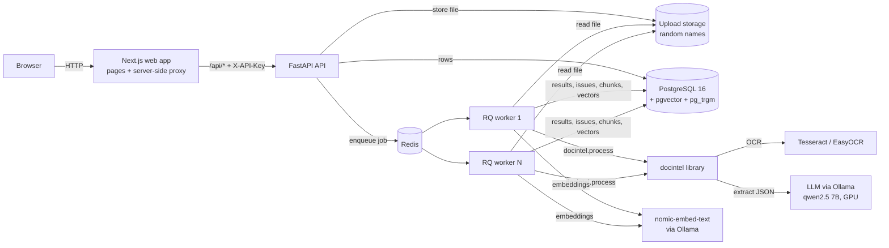
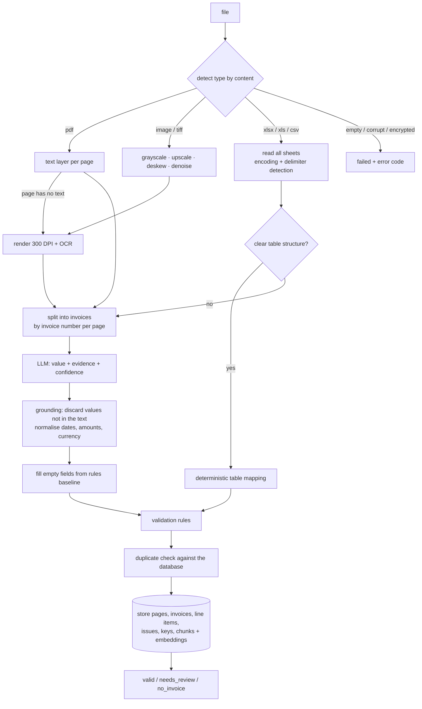

# Architecture

## Components

The API never does heavy work in the request: an upload is stored, recorded and queued, and returns immediately.
Workers are stateless, so throughput scales by starting more of them.

## Processing pipeline (one document)

## Technology choices

| Layer | Choice | Why (vs. the suggested stack) |
|---|---|---|
| Backend | Python FastAPI | OCR, PDF and LLM tooling are Python-native, so one language covers the pipeline and the API; Pydantic schemas and OpenAPI docs come for free (instead of Node.js/NestJS). |
| Queue | Redis + RQ | The Python equivalent of BullMQ: retries, failure registry, horizontally scalable workers. A thread mode is kept for setups without Redis. |
| Database | PostgreSQL 16 + pgvector + pg_trgm | One store for relational data, full-text search, fuzzy name search and vectors; no separate vector database to operate. |
| OCR | Tesseract 5 (EasyOCR optional on GPU) | Robust, easy to install; the OCR backend is pluggable. |
| LLM | Ollama (qwen2.5 7B, 8k context) via an OpenAI-compatible client | Runs locally on the GPU (private, no per-call cost); the same client works with OpenAI, Gemini, vLLM or Anthropic by changing `.env`. |
| Embeddings | nomic-embed-text via Ollama | Local; pluggable (sentence-transformers or a hash fallback). |
| Frontend | Next.js 15 (App Router) | As suggested; a server-side route handler proxies the API so the API key stays on the server. |
| Deployment | Docker Compose | Five services; Ollama stays on the host to use the GPU directly. |

## Failure handling

- Ingestion converts every problem into an error code; a worker never crashes on a bad file.
- A job that raises an unexpected exception marks the document `failed` with `INTERNAL_ERROR` and keeps the trace in
  the processing events. RQ keeps failed jobs, and `POST /api/documents/{id}/reprocess` re-queues any document.
- If the LLM is unreachable or returns invalid JSON (after retries), the rules baseline is used and a warning is stored.
- If embeddings fail, the document is still stored and keyword search still works.
