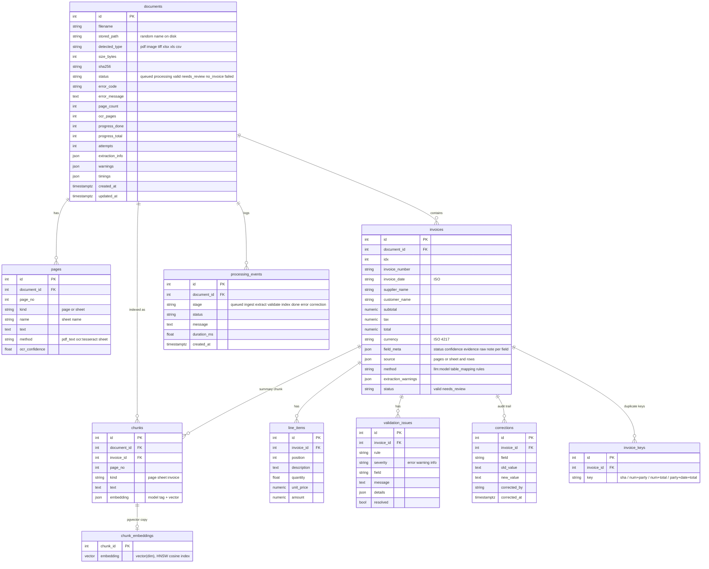

# Database schema

PostgreSQL 16 with the `pg_trgm` and `vector` (pgvector) extensions. Tables are created by SQLAlchemy at API startup
(`Code/api/models.py`, `Code/api/db.py`); the same models also run on SQLite for local use and tests.

## Indexes

| Index | Purpose |
|---|---|
| `GIN (to_tsvector('simple', chunks.text))` | keyword full-text search |
| `GIN (invoices.supplier_name gin_trgm_ops)`, same for `customer_name` | fuzzy name search |
| `HNSW (chunk_embeddings.embedding vector_cosine_ops)` | semantic search |
| `invoice_keys(key)` | duplicate lookup across the database |
| `invoices(invoice_number)`, `(invoice_date)`, `(total)`, `(status)`, `(invoice_number, total)` | filters |
| `documents(status)`, `(sha256)`, `(created_at)` | job lists, exact-duplicate files |

All child rows use `ON DELETE CASCADE`, so deleting or reprocessing a document removes its old results cleanly.
